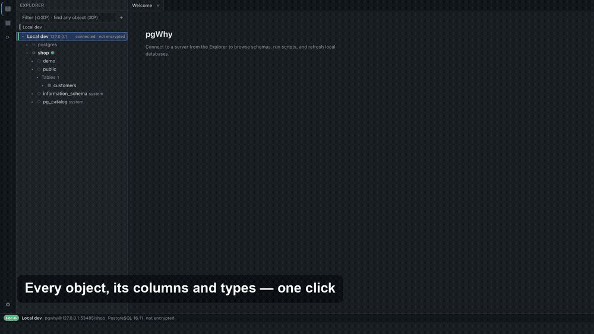

# pgWhy

A desktop Postgres client for people who miss SSMS. You get a dense object explorer, a SQL
editor, a results grid you can edit, and create/rename/drop/backup/restore for databases. It
can also refresh a local database from a remote one in a single step.



There's a longer [30-second video](docs/media/pgwhy-promo.mp4) too.

Built with Tauri (Rust backend, React frontend). Runs on macOS, Windows and Linux.

## Features

**Connections.** Password auth, every libpq `sslmode`, and SSH tunnels with key or password
auth. `verify-full` still checks the real hostname when you connect through a tunnel.
Passwords live in your OS keychain. Each connection gets an environment tag (Local, Dev,
Staging or Production), and the tag colours its tree node, tabs and status bar. A connection
with no tag is treated as Production.

**Explorer.** Server, databases, schemas, then tables with their columns and types inline. The
details panel shows keys, indexes, sizes and stats. You can filter the tree (⇧⌘P / Ctrl+Shift+P)
or jump to any object (⌘P / Ctrl+P). Right-click a table to script it as SELECT, INSERT,
UPDATE, DELETE or CREATE.

**Editor.** PostgreSQL highlighting and completion from the catalog. F5 or Ctrl+Enter runs the
selection, or everything if nothing is selected. Esc cancels. Errors are underlined where the
server reported them. Tabs autocommit. If you run `BEGIN`, the tab shows that a transaction is
open, and closing the tab or quitting asks whether to commit or roll back.

**Results.** Large results stream into the backend and scroll in a virtualized grid; a million
rows is fine. You can copy as TSV or export to CSV or JSON.

**Editing rows.** Double-click a table to see its top rows, with server-side sorting and
filtering. Tables with a primary key (or a unique, non-null key) can be edited. Changes stay
pending until you commit. You can preview the SQL first. The commit runs in one transaction and
fails if any statement doesn't touch exactly one row.

**Scripts.** A library of plain `.sql` files in a folder you choose, so you can keep it in git.
Recent scripts remember which connection they last ran against.

**Backup and restore.** Back up a database, schema or table with `pg_dump`, in custom or
directory format, with schema, data or both. Restore into a new database, replace an existing
one, or restore on top of one. Every backup and restore shows up in History, and any backup
there can be restored with one click.

## Destructive operations

Drop, rename, replace and the Refresh workflow only work on connections tagged Local or Dev,
and you have to type the database name to confirm. The backend enforces both, not just the UI.
Each server has one lock, so two of these operations can't run against it at the same time.

- **Drop and rename** disconnect other sessions first. If an application keeps reconnecting,
  pgWhy tells you which one. It won't roll back prepared transactions for you.
- **Drop** can take a backup first. That backup is kept for as long as the drop is in history.
- **Replace** never restores over the live database. It restores into
  `<name>_staging_<timestamp>`, checks the result, then swaps it in with two renames. If
  anything fails before the swap, your database is untouched. If the swap itself fails, pgWhy
  either renames everything back or leaves both copies and tells you which is which. History
  then offers "Complete swap" and "Roll back".
- **Restore on top** is for managed servers where your role can't create databases. It applies
  the archive over what's already there, and the dialog warns you before you start.

## Refreshing a local database from a remote one

A Refresh workflow pairs a source database (say, staging) with a local target. Running it asks
for confirmation once, then:

1. backs up the source with `pg_dump`, through the SSH tunnel if the connection has one
2. restores into `<target>_staging_<timestamp>`
3. runs your post-restore script against the staging copy, if you set one
4. checks the staging copy
5. swaps it in: renames the target to `<target>_old`, renames staging to the target, then
   drops `<target>_old`

If a step fails, you can retry from that step. The backup is reused when it's still valid.

There's also a drop-first strategy for machines without room for two copies. It drops the
target before restoring, so if the restore fails you're left with no target database until a
retry succeeds.

## Installing

There are no prebuilt releases yet; see [Building](#building). Builds are unsigned:

- **macOS:** the first time, right-click the app and choose Open.
- **Windows:** SmartScreen will say "Windows protected your PC". Click More info, then Run
  anyway.

### pg_dump and pg_restore

Backup, restore and "Script as CREATE" use the Postgres client tools installed on your machine.
pgWhy searches these places, in this order:

1. folders you add under Settings → Postgres client tools
2. `pg_config --bindir`
3. the usual install locations (Homebrew, Postgres.app, `C:\Program Files\PostgreSQL\N\bin`,
   `/usr/lib/postgresql/N/bin`, and so on)
4. your `PATH`

`pg_dump` has to be at least as new as the server it's backing up. pgWhy picks a version that
works, and if none does it tells you what to install (for example `brew install postgresql@17`).

### Credentials

Passwords and SSH passphrases go in the macOS Keychain, Windows Credential Manager, or Secret
Service on Linux (you need `gnome-keyring`, KeePassXC or similar running). If no keychain is
available, they're kept in memory for the session only. They're never written to pgWhy's
config files. `pg_dump` and `pg_restore` get the password through a temporary pgpass file
that only you can read, not on the command line.

## Troubleshooting

- **"pg_dump N cannot back up a PostgreSQL M server":** install client tools version M or
  newer, then restart pgWhy or add their folder under Settings → Postgres client tools.
- **"host key changed":** compare the fingerprint pgWhy shows with the output of
  `ssh-keygen -lf /etc/ssh/ssh_host_ed25519_key.pub` on the server. Only trust the new key if
  you know the server was rebuilt.
- **A restore fails with a locale or collation error:** the target server doesn't have the
  source database's locale. Install the locale, or restore to a server that has it.
- **"sessions still connected":** something keeps reconnecting to the database. The error
  names the process. Stop it and retry.
- **"`<db>_old` could not be dropped":** the replace worked, but another session was holding
  the old copy. You can drop it from History later.
- **A `.sql` file is refused for restore:** plain SQL dumps need `psql`, which pgWhy doesn't
  use. Back up in custom format (the default) instead.

## Building

You'll need Rust 1.94+, Node 24+, and Docker for the integration tests.

```bash
npm install                  # Tauri CLI
npm --prefix ui install
npm run dev                  # run the app with hot reload
npm run build                # build installers for your OS
```

### Tests

```bash
cargo test --workspace       # unit and integration tests; container tests skip without Docker
npm --prefix ui test         # UI tests
```

Set `PGWHY_SKIP_DOCKER=1` to skip the container tests, or `PGWHY_LOG=debug` for more logging.

End-to-end tests drive the real app with WebdriverIO against a Postgres container. They need
Docker and the Postgres 16 client tools:

```bash
npm --prefix e2e install
npm --prefix e2e run build:app      # debug build with the e2e feature
npm --prefix e2e test
E2E_PERF=1 npm --prefix e2e test    # also run the performance checks
```

The e2e app uses a temporary config folder and in-memory credentials, so it won't touch your
real settings or keychain. Every spec file shares one app process, so specs create their own
connections and shouldn't assume a clean slate. Shared steps are in `e2e/helpers.ts`.

To try the UI in a browser against a fake backend, run `npm --prefix ui run dev` and open
`http://localhost:5173/demo.html?scene=editor` (other scenes: `grid`, `workflows`).

The promo video is generated from the app by `scripts/promo.sh`, which also needs ffmpeg and
Pillow.

### Layout

| Path | |
|---|---|
| `crates/pgwhy-core` | connections, TLS, SSH tunnels, catalog queries, query execution, results, scripts |
| `crates/pgwhy-pgtools` | finding and running `pg_dump` / `pg_restore` |
| `crates/pgwhy-workflow` | drop/rename/restore and the Refresh workflow |
| `crates/pgwhy-errors` | shared error types |
| `src-tauri/` | Tauri commands, a thin layer over the crates |
| `ui/` | React frontend |
| `e2e/` | end-to-end tests |

## License

MIT. See [LICENSE](LICENSE).
